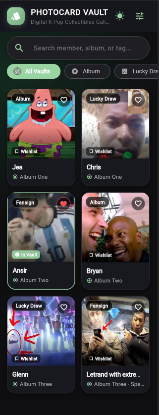
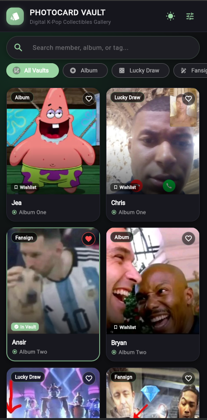
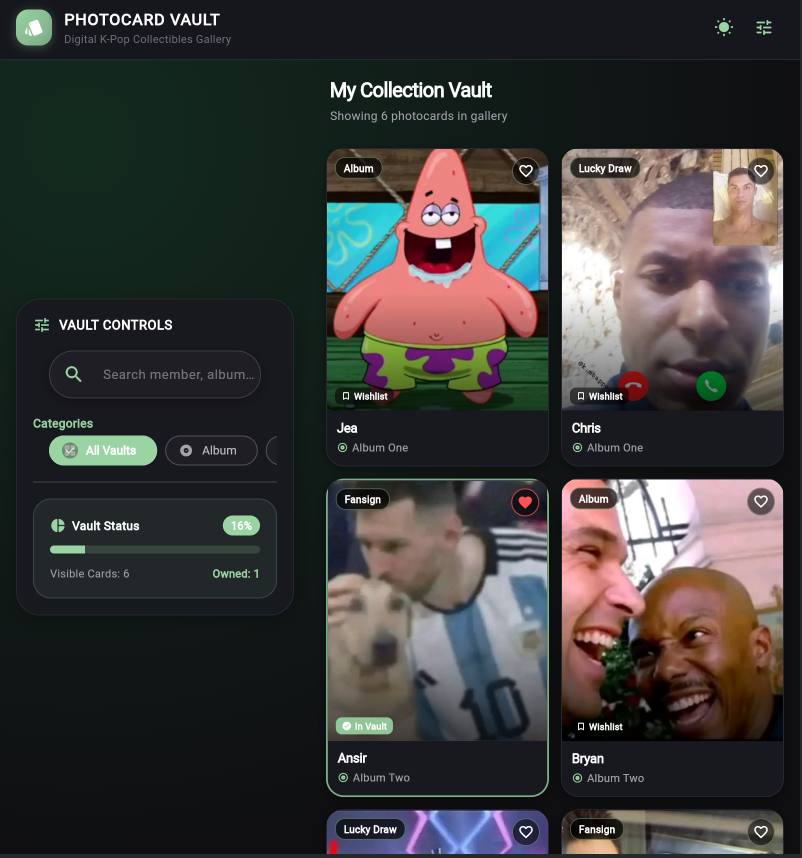
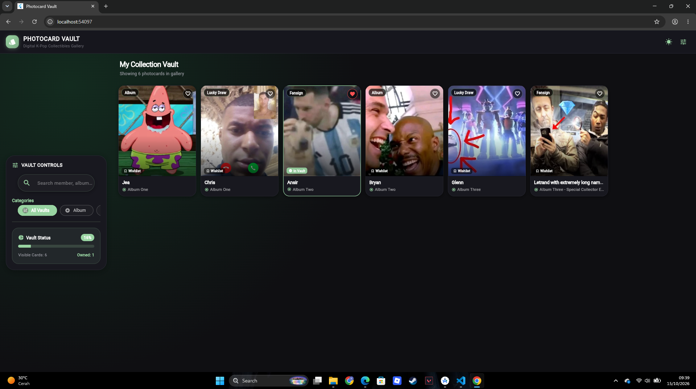
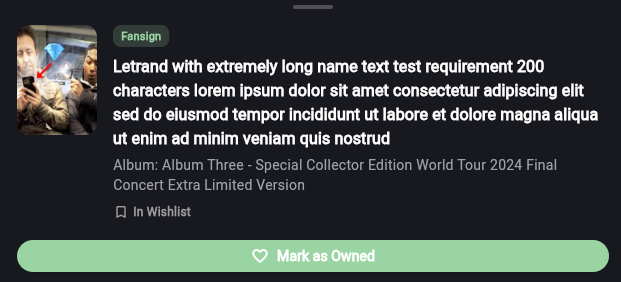
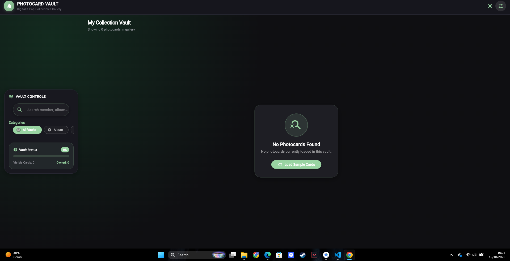
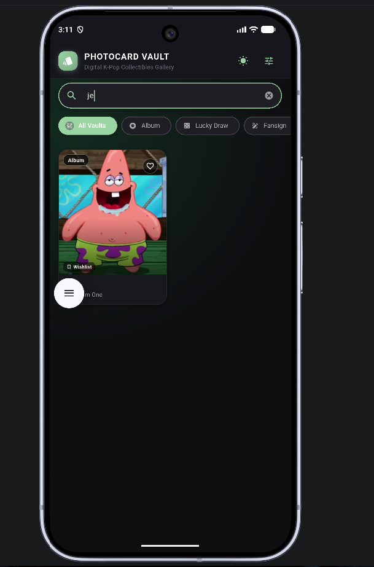
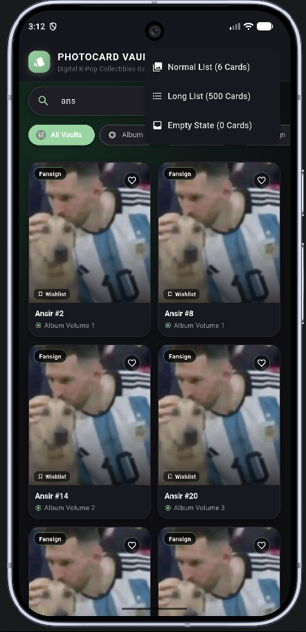
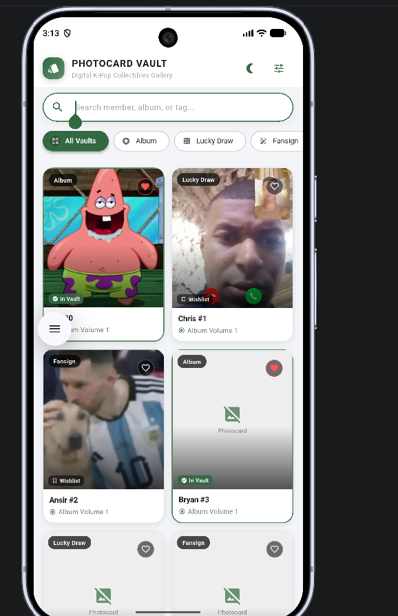

# Laporan Pengujian Responsif UI (Week 04 - H1)

Di bagian ini, saya melakukan pengujian responsif pada layar **Photocard Vault** (`CollectionScreen`) menggunakan 9 skenario pengujian yang berbeda. Tujuannya adalah memastikan aplikasi tetap rapi, nyaman digunakan di berbagai ukuran layar, dan yang paling penting **bebas dari error garis kuning-hitam (*yellow stripes*)**.

---

## Ringkasan Catatan Layout
- **Breakpoints**: Menggunakan `LayoutBuilder` dengan batasan `maxWidth >= 600dp`.
  - **Tampilan HP (< 600dp)**: Layout 1 kolom vertikal yang pas buat layar HP.
  - **Tampilan Tablet/Desktop (>= 600dp)**: Otomatis berubah jadi **2 Pane Split Screen** (Panel kontrol/sidebar di kiri, galeri kartu di kanan).
- **Teks Panjang**: Semua widget `Text` dipasang `maxLines` dan `overflow: TextOverflow.ellipsis` biar nggak merusak layout pas nemu teks kepanjangan.
- **Empty State**: Kalau data lagi kosong (0 item), muncul tampilan khusus dengan ikon, pesan, dan tombol reset biar nggak cuma nampilin layar putih polos.
- **Scroll Mulus**: Pada daftar 500 item, properti `shrinkWrap: true` dihapus dan dibungkus `Expanded` biar scroll-nya tetep mulus tanpa lag.

---

## Tabel Hasil Pengujian 9 Checklist

| Tampilan / Screenshot | Kasus Pengujian | Status | Catatan Solusi & Perbaikan |
|---|---|---|---|
|  | **Small Phone** (Lebar 320 dp) | **PASS** | Filter tag dibungkus `SingleChildScrollView` horizontal dan padding kartu disesuaikan biar pas di layar HP mini tanpa overflow. |
|  | **Large Phone** (Lebar 430 dp) | **PASS** | Grid kartu beradaptasi otomatis pake `SliverGridDelegateWithMaxCrossAxisExtent(220)` nampilin 2 kolom yang pas dan seimbang. |
|  | **Tablet** (Lebar 800 dp) | **PASS** | Layout berubah lewat `LayoutBuilder`: dari 1 kolom vertikal berubah jadi 2 Pane (Sidebar kontrol di kiri + Galeri kartu di kanan). |
|  | **Landscape** (Layar Diputar) | **PASS** | Begitu layar diputar ke lanskap, `LayoutBuilder` mendeteksi lebar tambahan dan otomatis pindah ke layout 2 Pane. |
|  | **Long Text** (Teks 200 Karakter) | **PASS** | Diuji pake nama member 200+ karakter. Teks terpotong rapi pake `TextOverflow.ellipsis`. Kalau kartu di-tap, muncul modal buat liat teks lengkapnya. |
|  | **Empty State** (0 Item) | **PASS** | Diuji pas data 0 item. Muncul komponen `EmptyState` lengkap dengan ikon inbox, pesan deskriptif, dan tombol aksi reset. |
|  | **Long List** (500 Items) | **PASS** | Diuji pake 500 kartu. Properti `shrinkWrap: true` dihapus dan dibungkus `Expanded` biar scroll-nya lancar 60fps tanpa nge-freeze. |
|  | **Keyboard** (Layar Pendek + IME) | **PASS** | Search bar sama grid ditaruh di dalam `Column` + `Expanded`, jadi pas keyboard muncul, kolom search tetep keliatan jelas di atas keyboard. |
|  | **Dark Mode** (Mode Gelap) | **PASS** | Memanfaatkan `AppTheme.darkTheme` & `AppTheme.lightTheme` pake `Theme.of(context)` biar warna teks dan kartu tetep kontras dan enak dibaca. |

---

## Kesimpulan
Aplikasi telah diuji pada seluruh 9 skenario dan **semuanya LULUS (PASS)** tanpa ada error overflow garis kuning-hitam atau elemen UI yang saling bertumpuk.
